# SQL Disk Monitor

A Windows desktop tool for DBAs that shows how hard SQL Server is working its storage: which disk every database file is on, how close each disk is to its provisioned IOPS and throughput, when in the day the pressure builds, how fast space is running out, and what the storage costs.

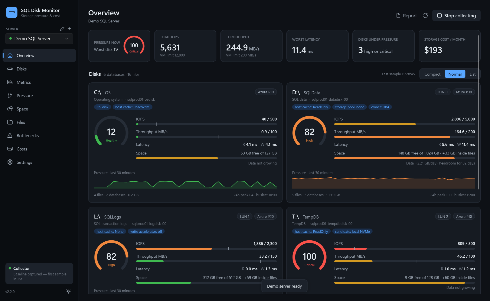

---

## What it does

**Disk inventory**
- Maps every database file to the volume it lives on (drive letters and mount points), with size, used space inside the file, growth settings and max size.
- Tag each disk by hand with a label, a **drive name**, a **disk name** (for example the Azure managed disk resource name), **LUN**, disk number, device model, tier, **max IOPS, max MB/s, burst IOPS and burst MB/s**, provisioned size, cost and free-form **tags** (for example `host cache: ReadOnly, SAN: Pure-02, owner: DBA`).
- Drive and disk names, LUNs and tags appear on every disk card. The **Inventory** view on the Disks page lists every disk in one editable grid, with a CSV export.
- **Presets** fill in the published limits for Azure Premium SSD P1–P80 (including credit-based burst), Premium SSD v2, Ultra, AWS gp3/io2/st1 and GCP Hyperdisk.
- **Detect LUNs from host** reads disk numbers, SCSI LUNs and models from the SQL Server host over WMI.
- **Import from CSV**: fill in disk settings for many disks at once. **CSV template** saves a file with the right column headers and one row per volume. Fill in the blanks (in Excel, for example) and choose **Import CSV**.
  - Rows are matched to disks by the first column (`F`, `F:`, `F:\` or a mount-point path), or by a column named Volume or Drive letter if there is one.
  - Only empty fields are filled; values already entered are never overwritten. Unknown columns and unmatched rows are reported.
  - Recognised columns: Label, Drive name, Disk name, LUN, Disk number, Device / model, Tier, Max IOPS, Max MB/s, Burst IOPS, Burst MB/s, Size GB, Monthly cost, Cost per GB, Cost per IOPS, Cost per MB/s, Tags, Notes. Common variations (for example `IOPS`, `Resource name`, `SKU`) also work.
- **Notes**: a free-text description per disk, plus a timestamped change log ("upgraded to P40", "added tempdb files") that appears as markers on the charts.

**Overview**
- Disk cards come in three layouts, remembered between launches: **Compact** (four per row, the headline numbers only), **Normal** (full detail) and **List** (one short row per disk).

**Azure integration**
- **Sync from Azure** (Disks page): sign in in the browser (cached), or reuse `az login`. Pick the VM; the app suggests the one whose computer name matches the SQL Server host. Reader access is enough, and nothing in Azure is changed.
- For each managed disk it reads the disk name, LUN, type and **tier** (including a performance tier set above the size's own tier), provisioned **IOPS and MB/s**, bursting (credit-based or on-demand), size, host caching, write accelerator, zone, encryption, network access and creation date.
- It shows the **next size up** (size, IOPS, MB/s and extra monthly cost) and whether the disk is **expandable** (online, needs the VM deallocated, at maximum size, or shared). Monthly prices come from the Azure retail price list in your currency.
- It also reads the VM size's **uncached disk limit** and data-disk slots. A finding flags when the VM, not the disks, is the cap.
- Disks are matched to Windows volumes using, in order:
  - a previous sync, and the OS disk to C:
  - recorded LUNs and **pool LUNs**
  - an Azure disk **tag** naming the volume
  - the volume's **label or drive name inside the disk name**
  - a unique size, or an equal-sized storage pool (such as the SQL Server images' `SQLVMDATA1`, whose disks' limits are added together)
  - Windows disk order for same-sized disks, marked for you to check

  You confirm the matches before anything is saved.
- For exact matching with Reader-only access, **Copy LUN script** gives you [a PowerShell script](tools/Get-DiskLuns.ps1) to run on the VM. It writes a CSV of each drive letter's LUN, including the LUNs behind storage pools. Import it with Import CSV, then sync, and every disk matches by LUN.
- Azure owns the disk name, LUN, tier, limits, size, host-cache tag and cost. Your label, drive name, notes and other tags are never changed, and tier or limit changes are added to the disk's change log.

**Reports**
- **Report** in the top bar creates a tidy **HTML or PDF** report for the period selected in the app. It includes a summary with headline figures, disks (with Azure details), the pressure heatmap, trend charts, findings and recommendations, space and growth, costs, IO waits and an optional file appendix. Choose which sections to include.
- Example: [sample report (PDF)](docs/sample-report.pdf) · [HTML](docs/sample-report.html), from the demo server.
- Reports are always laid out on a light, print-friendly background. PDFs are printed by the Edge engine built into Windows (WebView2), so they match the HTML exactly.
- Scheduled reports: `SQLDiskMonitor.exe --report "C:\Reports\prod.pdf" --server "Prod SQL" --range 7d` writes a report without opening the app, so you can run it from Task Scheduler. Use `.html` for HTML, and add `--files` for the file appendix.

**Disk pressure score**
- A 0–100 score per disk per sample. It measures how hard SQL Server is pushing the disk, not hardware health:
  - **Capacity**: IOPS and MB/s as a percentage of the limits you set. Whichever is higher counts.
  - **Latency**: read and write latency scored against configurable good / warning / critical thresholds. Volumes that mostly take log writes use stricter log thresholds. Latency is ignored when there are too few IOs per second to be meaningful.
  - **Pressure** = the higher of the two. Bands: Healthy < 40, Elevated 40–70, High 70–90, Critical 90+.
- A **heatmap by hour of day** for every disk, and a **day-of-week × hour** heatmap for one disk, show when the pressure happens (average or peak).

**Metrics**
- IOPS, throughput, read and write latency, pressure and pending IO over 15 minutes to 30 days, grouped by disk or by database.
- Max and burst limits drawn on the charts, an optional read/write split, and note markers.
- Click a disk pill to show or hide it. Right-click it to **show only that disk**, hide it, show all disks or invert the selection.
- CSV export.

**Space**
- Total, used and free space per disk, with used space over time.
- A growth trend in GB/day and a **days-until-full** forecast for each disk.
- **Headroom** = volume free space + unused space inside the database files. Pre-sized data files grow internally, so a disk can look nearly full and still have plenty of room.
- **Space alerts** in Settings: turn free space off as a health signal entirely, or count unused space inside data files as headroom (the default). In that mode the fill-date forecast follows data growth inside the files rather than file autogrowth, and you choose the warning threshold (% free).
- Allocated vs used space for each database and file (checked every 15 minutes), with growth per day and autogrowth event counts.

**Bottlenecks**
- Ranked findings with recommendations:
  - disks at their IOPS or throughput cap, or living on burst credits
  - high read latency, or high log-write latency
  - a single file causing most of a disk's IO wait
  - disks running out of space, with a fill-date forecast
  - frequent autogrowth and percentage autogrowth
  - data and log files sharing a disk, and tempdb sharing a disk with user databases
  - WRITELOG and PAGEIOLATCH waits
  - disks with limits not yet configured
  - over-provisioned disks, with a smaller preset suggested
- **Export HTML report**: a self-contained report for change requests or the infrastructure team.

**Costs (optional)**
- Turn on in Settings. Enter a fixed monthly price, or per-GB / per-IOPS / per-MB/s prices for disks billed on provisioned capacity.
- Shows cost per disk, cost per used GB, cost per million IOs, the cost of headroom above the p95 workload, and each disk's cost split across its databases by space or by IO.

**App**
- Dark and light themes (or follow Windows), using WPF's Fluent styling.
- Monitors several servers at once in the background. Minimises to the notification area, and can start with Windows.
- Installs from an MSI. It checks GitHub for new releases at startup and can download and install an update in place.
- **Demo server**: a week of realistic synthetic data, to explore the app without connecting to anything.

## Screenshots

| | |
|---|---|
| 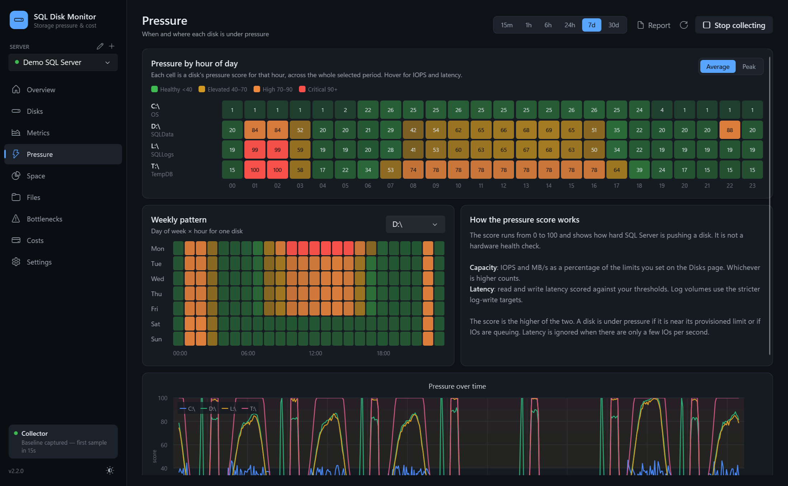 **Pressure heatmaps** | 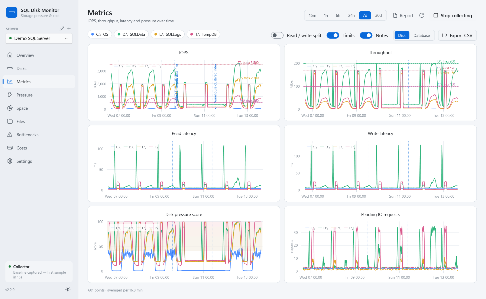 **Metrics with limits and notes** |
| 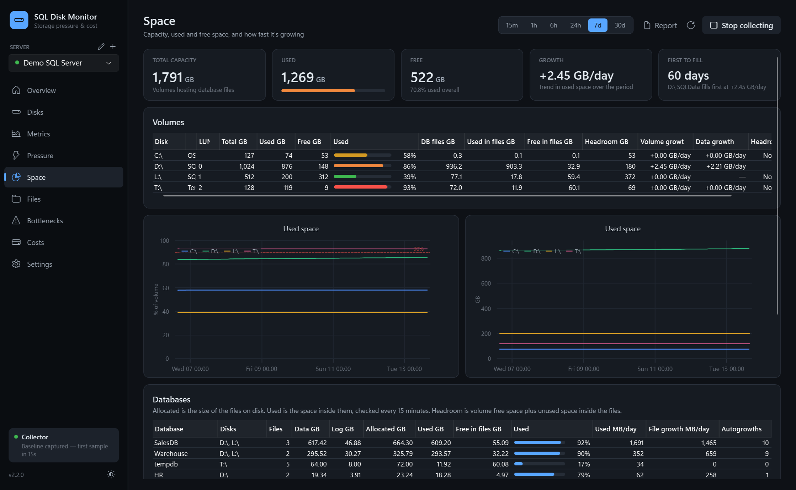 **Space and growth** | 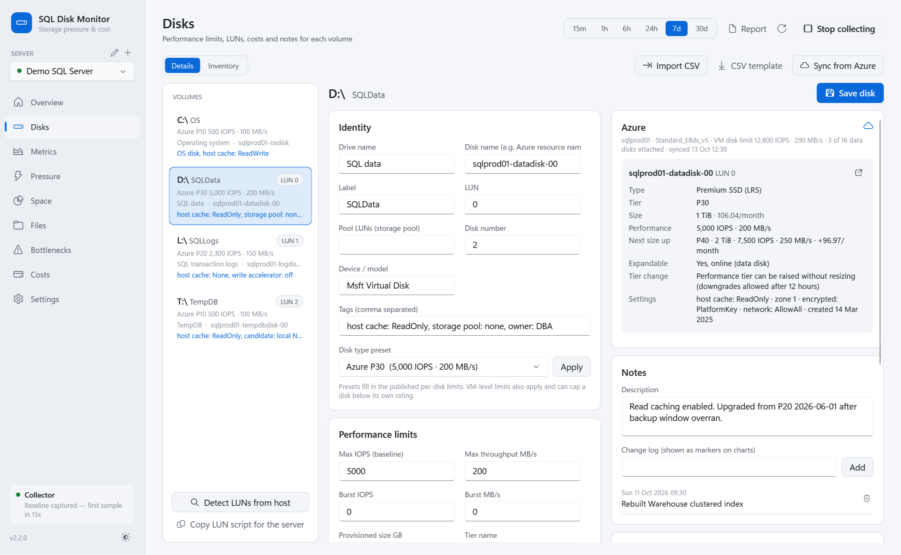 **Disk limits, LUN, cost and notes** |
| 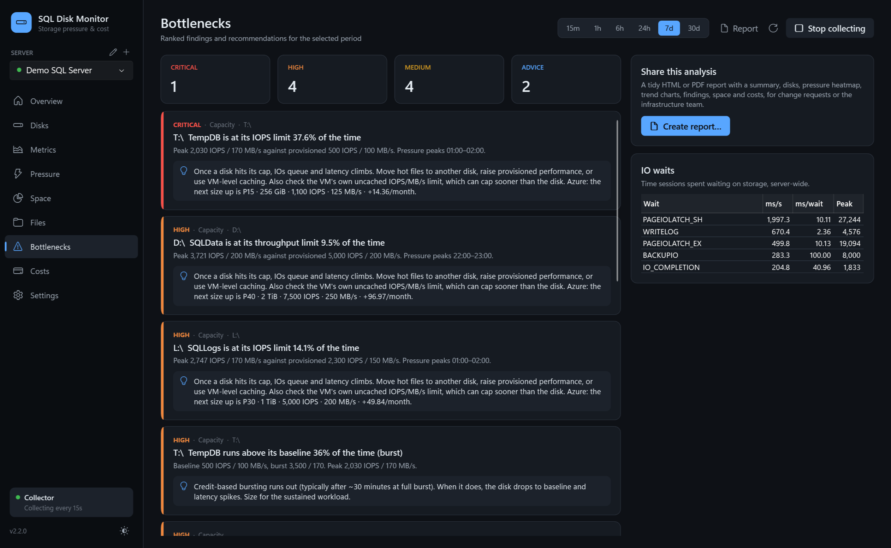 **Bottlenecks** | 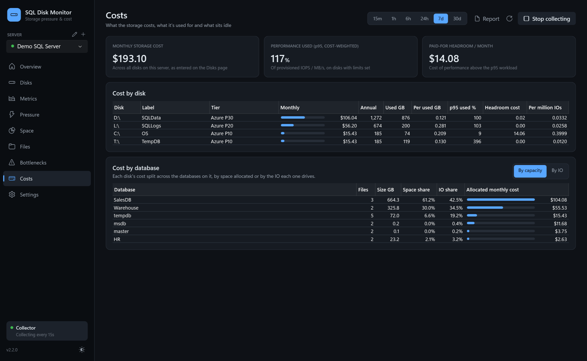 **Costs** |
| 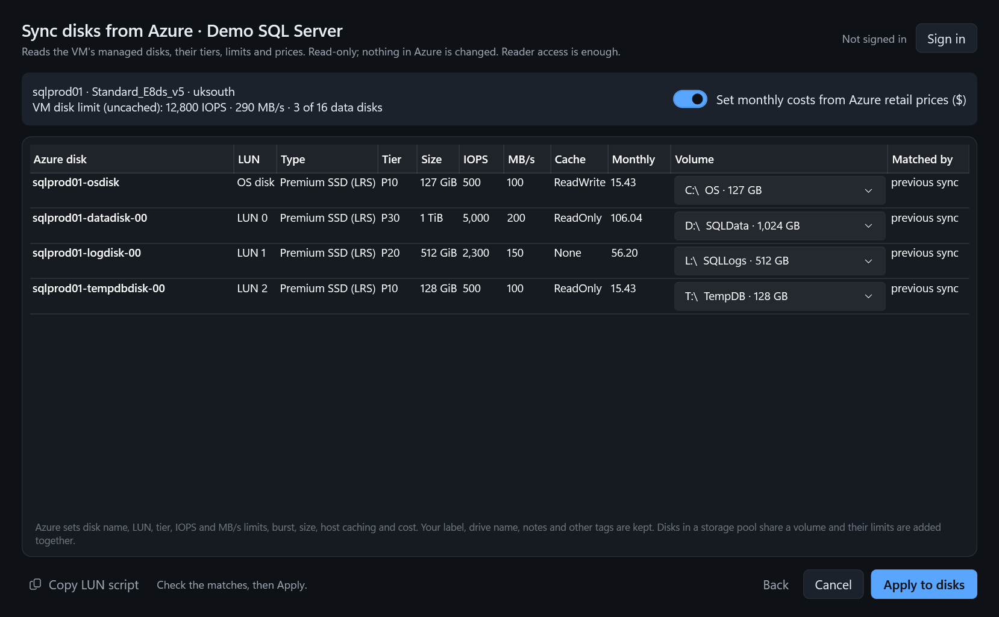 **Sync from Azure** | 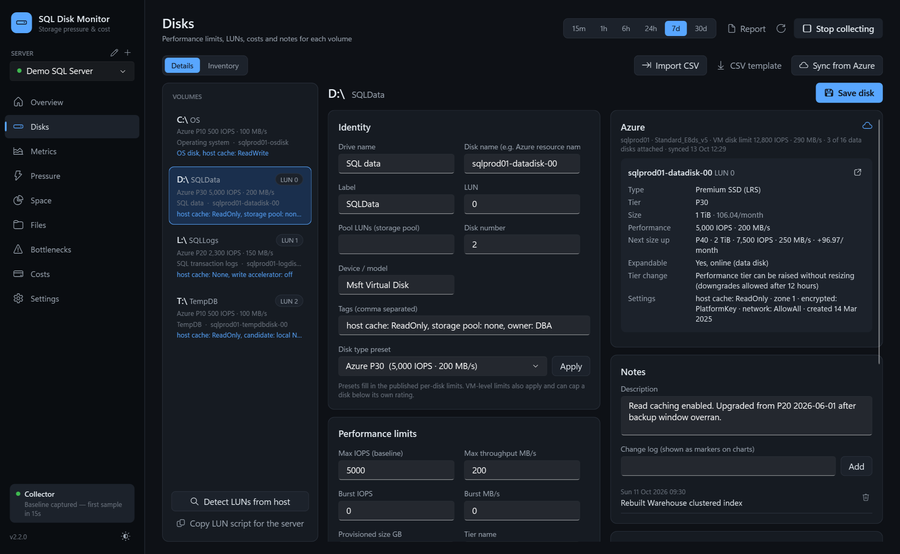 **Azure details per disk** |
| 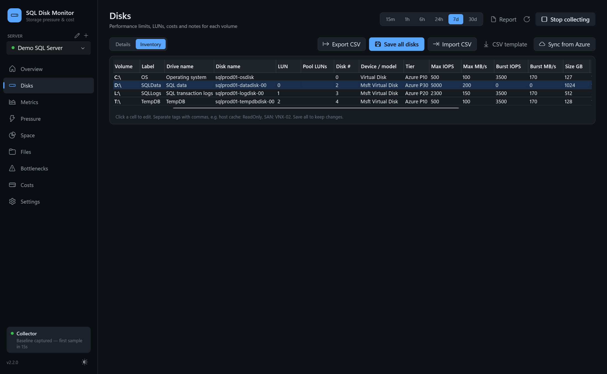 **Disk inventory, editable in place** | 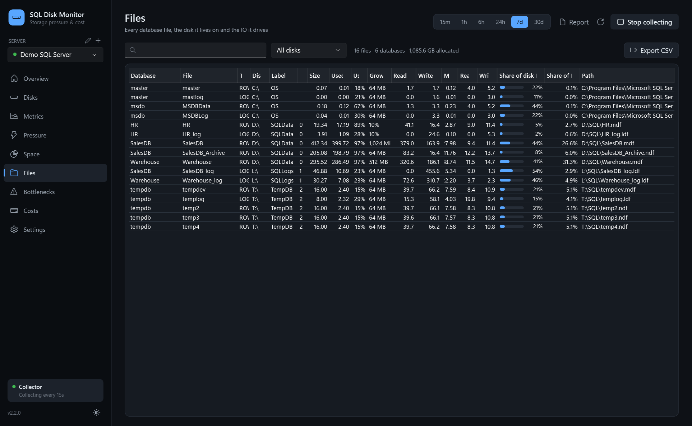 **Files** |
| 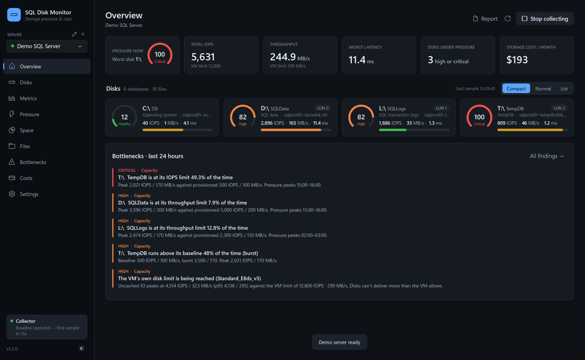 **Overview: compact cards** | 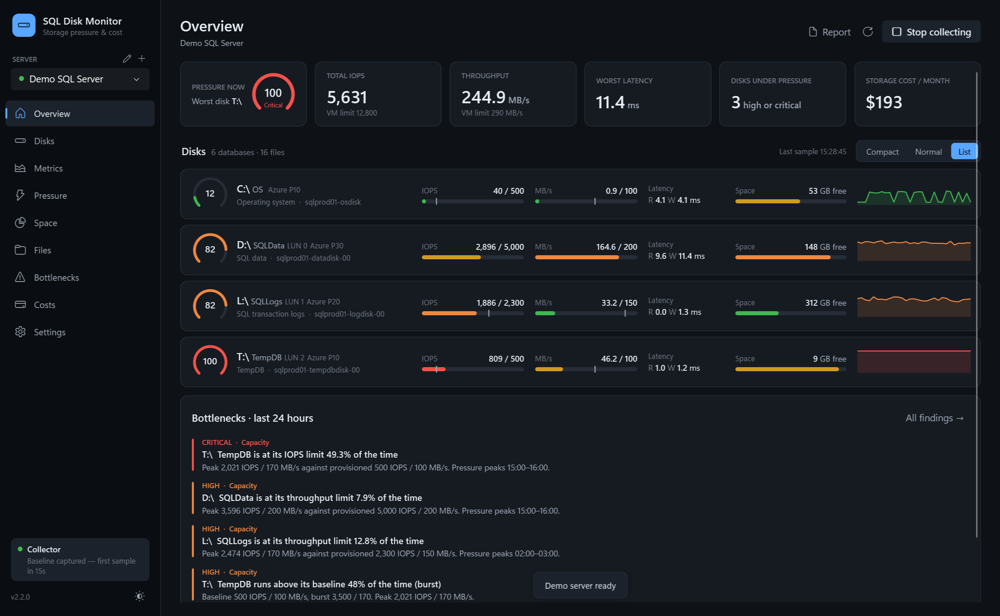 **Overview: list layout** |
| 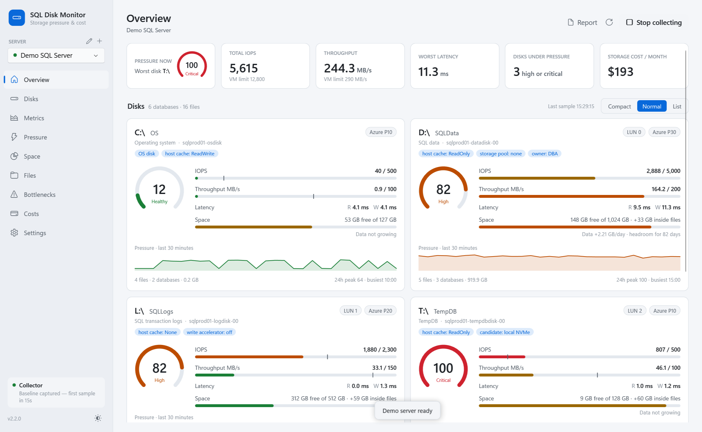 **Light theme** | 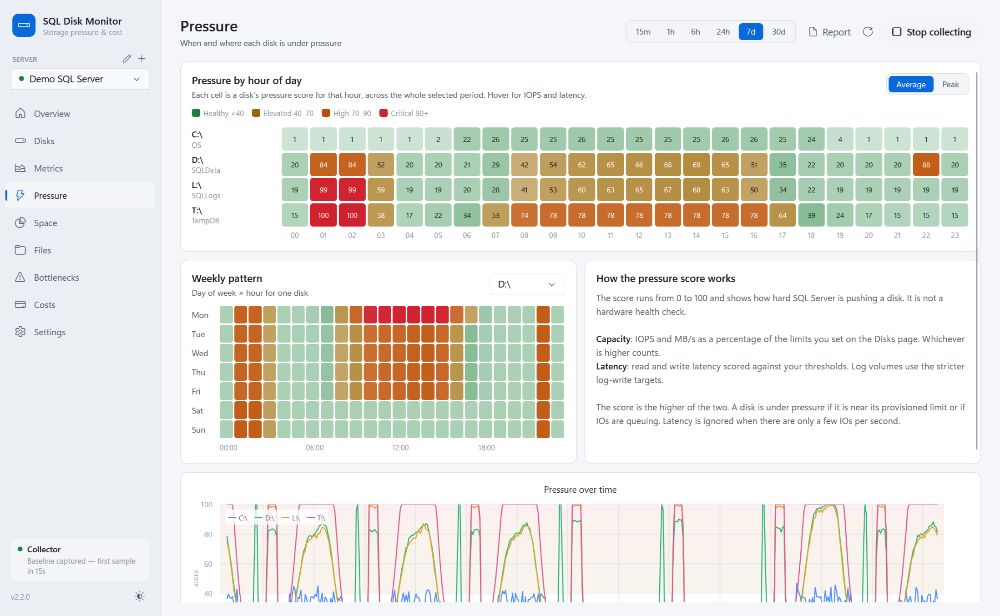 **Light theme heatmaps** |

## Install

1. Download `SQLDiskMonitor-x.y.z.msi` from [Releases](../../releases).
2. Run it. It installs per machine to `Program Files\SQL Disk Monitor` and adds a Start menu shortcut.
3. When a new release is published, the app shows an update banner. **Download & install** runs the new MSI, which upgrades in place, and then restarts the app. You can turn the check off, or skip a version, in Settings.

The app is self-contained, so no .NET runtime install is needed.

## Requirements

- Windows 10 or 11, x64.
- SQL Server 2016 or later (on-premises, VM or Azure SQL Managed Instance).
- A login with **VIEW SERVER STATE**. Used-space figures also need access to each database; databases the login can't enter are skipped.
- **Sync from Azure** needs Reader on the VM's subscription or resource group.
- **Detect LUNs** needs remote WMI access to the SQL Server host, which normally means local admin. Without it, enter LUNs by hand.
- Authentication: Windows, SQL login, Microsoft Entra integrated or Entra password. Passwords are stored in Windows Credential Manager.

## Getting started

1. **Add a SQL Server** in the side bar, or choose **Explore with demo data**.
2. Collection starts straight away. The first figures appear after one interval (15 seconds by default).
3. On **Disks**, pick a preset or enter max IOPS, MB/s and burst limits for each disk, plus LUN, tags, cost and notes. Use **Inventory** to fill in every disk in one grid. Without limits, pressure is based on latency only.
4. Use **Pressure**, **Space** and **Bottlenecks** with a 24-hour or 7-day range to see when and where the disks struggle.

| Key | Action |
|---|---|
| F5 | Refresh the current page |

## How it works

On each interval the collector runs one lightweight query against:

| DMV | Used for |
|---|---|
| `sys.dm_io_virtual_file_stats` | Cumulative reads, writes, bytes and IO stall per file |
| `sys.master_files` | File names, types, sizes and growth settings |
| `sys.dm_os_volume_stats` | Volume mount point, label, total and free bytes |
| `sys.dm_io_pending_io_requests` | IOs currently outstanding per file |
| `sys.dm_os_wait_stats` | IO-related waits (PAGEIOLATCH, WRITELOG, IO_COMPLETION…) |

Differences between successive snapshots give IOPS, MB/s and average latency (stall ÷ IOs) per file. These are added up per volume and scored. Every 15 minutes, `FILEPROPERTY(name, 'SpaceUsed')` is read in each accessible database for used space.

These are SQL Server's own IO figures. Reads served from the buffer pool don't appear, and IO from other processes on the same disk isn't counted. Cloud disks are also capped by the VM's own IOPS and throughput limits, which can be lower than a single disk's rating.

History is kept in a local SQLite database at `%LOCALAPPDATA%\SQLDiskMonitor\history.db`: 30 days of disk samples and 7 days of per-file samples by default. Nothing is installed on, or written to, the SQL Server. The only outbound call the app makes is the GitHub release check.

## Build from source

Prerequisites: the [.NET 10 SDK](https://dotnet.microsoft.com/download). The WiX toolset is restored from NuGet.

```bash
dotnet test tests/SQLDiskMonitor.Tests
pwsh build/build.ps1 -Version 2.0.0        # self-contained exe + MSI into ./artifacts
pwsh build/screenshots.ps1                 # regenerate docs/screenshots from the demo server
```

The integration test runs against a real instance when `SQLDM_TEST_SERVER` is set (for example `.\SQLEXPRESS`).

Build from a short path such as `C:\src\SQLDiskMonitor`. Windows Installer and WPF's native libraries fail when the path is very long.

### Releasing

Push a tag like `v2.1.0`. The **Release** workflow tests, builds the MSI and publishes a GitHub release. Installed copies pick it up at their next start.

## Tech stack

.NET 10 · WPF with the Fluent theme · CommunityToolkit.Mvvm · OxyPlot · Microsoft.Data.SqlClient · SQLite · WiX 5

## License

MIT. See [LICENSE](LICENSE).

## Author

**Jake Morgan**, [Blackcat Data Solutions Ltd](https://blackcat.wales)
